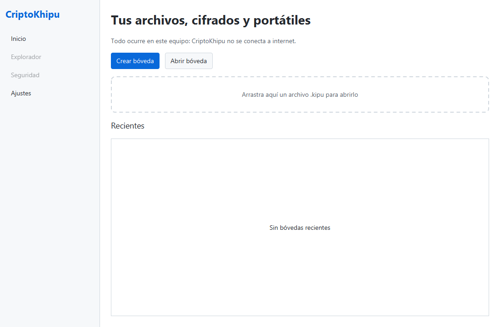
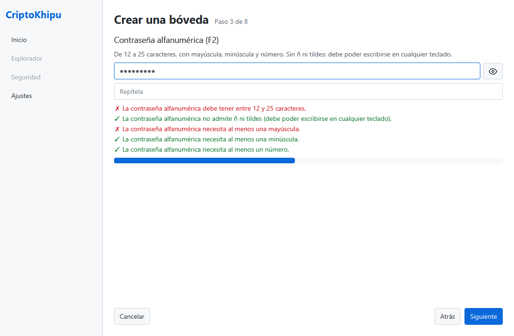
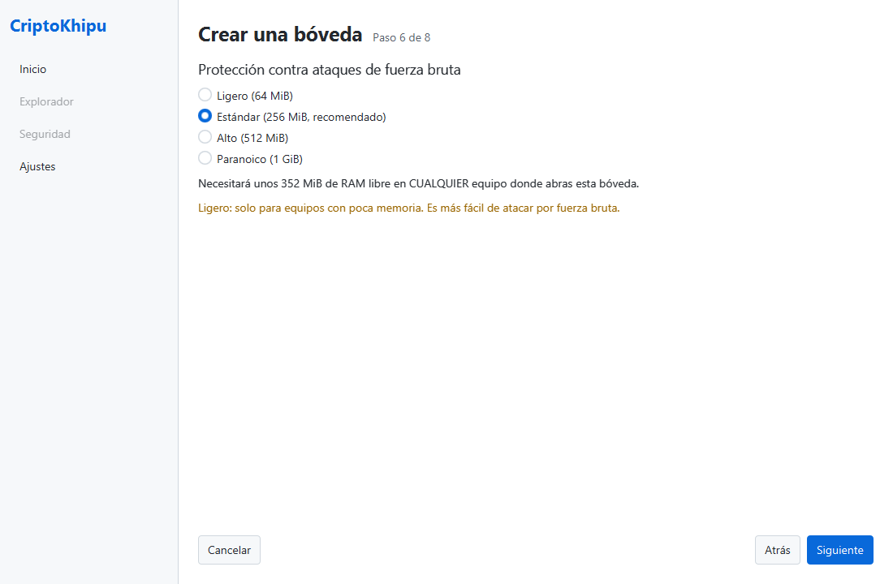
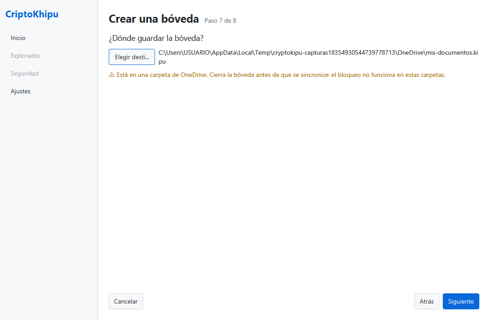
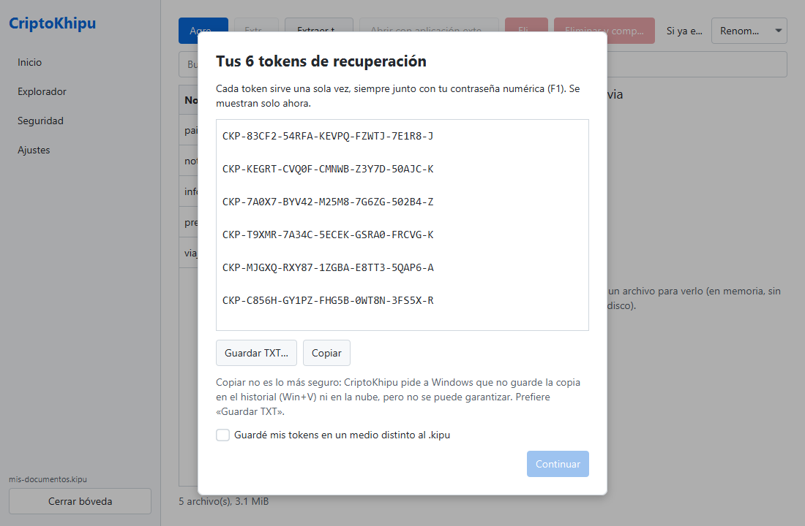
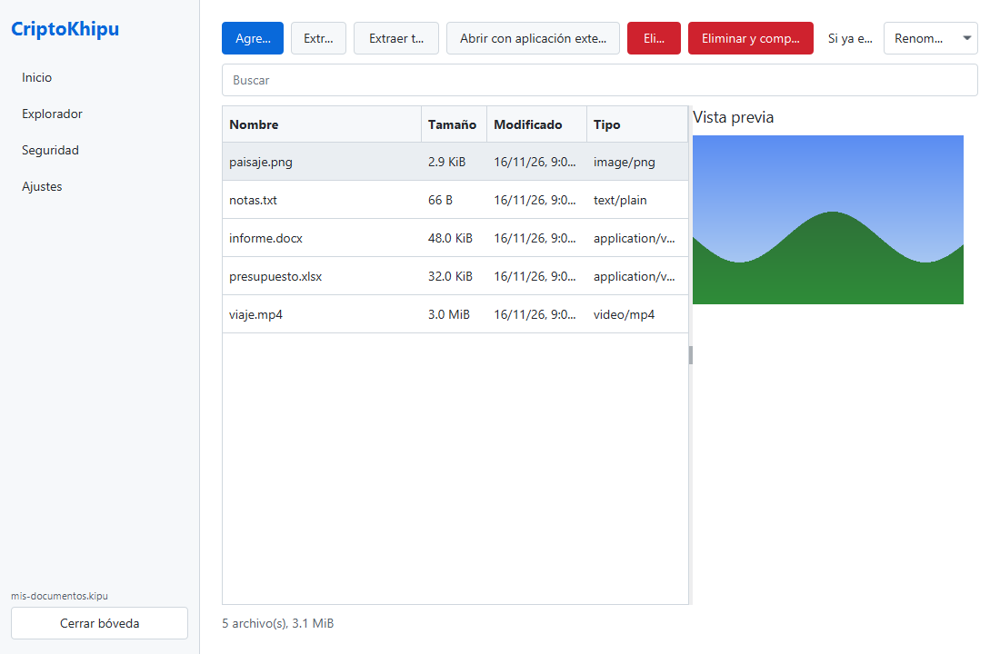
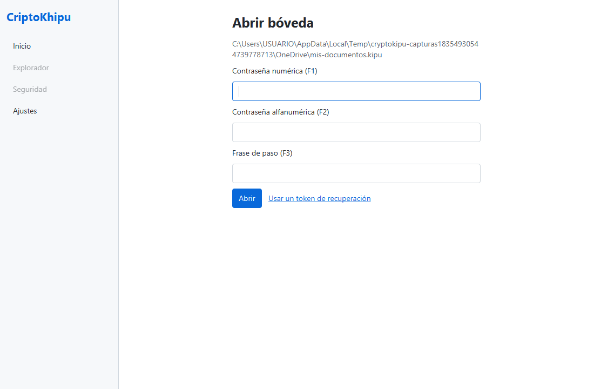
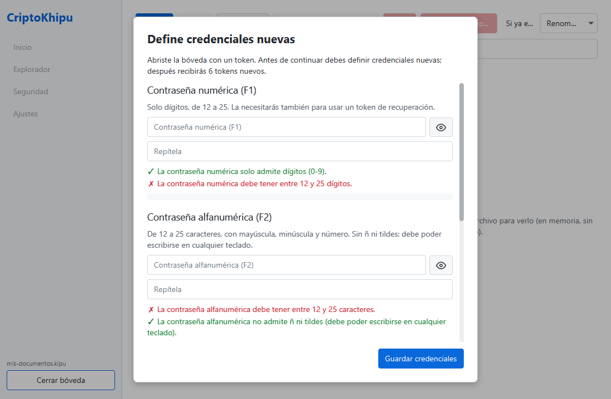
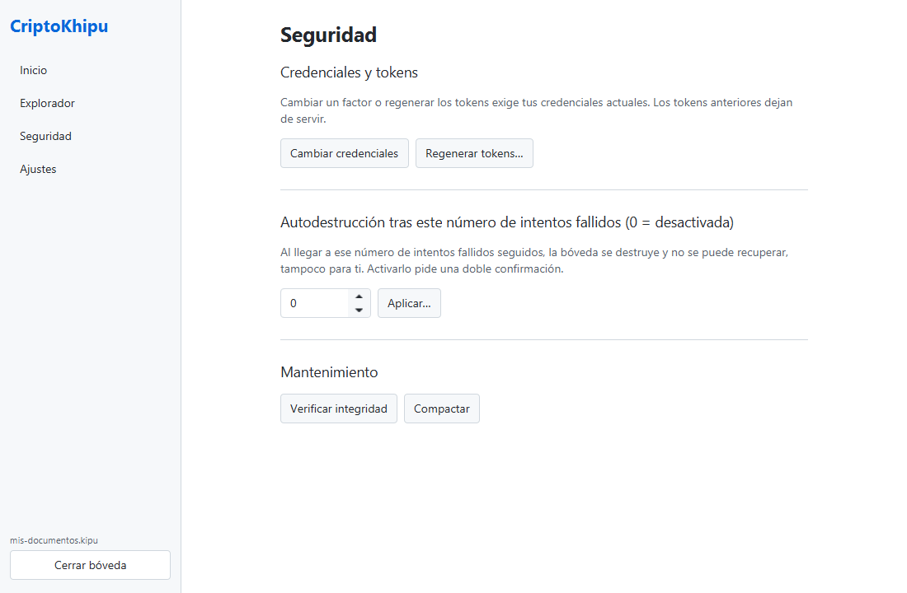
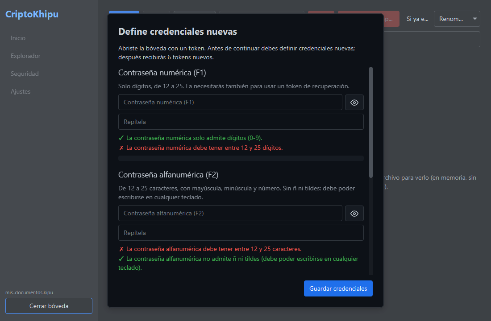

# CriptoKhipu

Cifrador de archivos de escritorio, 100% offline, escrito en Java 25. En desarrollo: ver [PLAN_IMPLEMENTACION.md](PLAN_IMPLEMENTACION.md).

## Compilar y verificar

Requiere solo un JDK 17 o superior para arrancar Gradle; el JDK 25 (Temurin) lo descarga Gradle la primera vez.

```bash
./gradlew check
```

`check` compila, ejecuta las pruebas, la regla de nombres `Mija` (Checkstyle) y las reglas de arquitectura (ArchUnit).

## Interfaz gráfica

```bash
./gradlew :cryptokipu-ui:ejecutarUi
```

| | |
|---|---|
|  |  |
| Inicio: crear, abrir (o arrastrar un `.kipu`) y recientes | Asistente: cada regla de la contraseña se marca al escribir |
|  |  |
| Perfil de Argon2id y la RAM que pedirá en cualquier equipo | Avisos del destino: carpeta sincronizada, FAT32, espacio |
|  |  |
| 6 tokens de un solo uso: no se continúa sin confirmar | Explorador con vista previa en memoria |
|  |  |
| Desbloqueo (la llave se pide solo si la bóveda la usa) | Tras usar un token, la rotación es obligatoria |
|  |  |
| Seguridad: credenciales, tokens, autodestrucción, mantenimiento | Tema oscuro (sigue al sistema) |

Más capturas en [docs/capturas](docs/capturas/); se regeneran con `./gradlew :cryptokipu-ui:generarCapturas`.
Pruebas de la interfaz y lista de verificación manual: [docs/PRUEBAS_UI.md](docs/PRUEBAS_UI.md).

## Formatos que se pueden ver sin extraer

Todo se descifra **en memoria**; nada se escribe en disco (ver [docs/GUIA_USB.md](docs/GUIA_USB.md) para llevar tu bóveda
en un USB y [docs/THREAT_MODEL.md](docs/THREAT_MODEL.md) para lo que no se puede controlar).

| Formato | Vista previa | Cómo |
|---|---|---|
| PNG, JPG, GIF, BMP | Imagen (hasta ~100 megapíxeles; se leen las dimensiones antes de decodificar) | JavaFX `Image` |
| TXT, MD, CSV, JSON, XML, código | Texto (hasta 10 MB) | Visor de texto |
| PDF | Páginas renderizadas bajo demanda | PDFBox 3, caché solo en memoria |
| DOCX, XLSX | Texto de párrafos, tablas y hojas (fidelidad parcial) | Apache POI, sin temporales |
| PPTX | Diapositivas dibujadas (fidelidad parcial) | Apache POI + Java2D sin pantalla |
| MP4 (H.264 + AAC), M4A, MP3, WAV, AIFF | Reproductor con adelantar/retroceder | `MediaPlayer` + servidor local `127.0.0.1` con token y `Range` |
| MKV, AVI, WebM, HEVC, FLAC, MOV, DOC/XLS/PPT | No se muestra | «Abrir con aplicación externa» (copia temporal con aviso) |

Los visores de PDF y Office son un módulo opcional (`cryptokipu-visores`); sin él, esos formatos van a la aplicación externa.

## Línea de comandos (`kipu`)

Los secretos (F1, F2, F3, tokens) **nunca** se pasan como argumentos: se piden por la consola.

```bash
kipu keyfile --generar mi.kipukey
kipu create --out fotos.kipu --keyfile mi.kipukey --tokens-out tokens.txt ./fotos
kipu info fotos.kipu
kipu list fotos.kipu --keyfile mi.kipukey
kipu extract fotos.kipu --keyfile mi.kipukey --todo --to ./restaurado
kipu recover fotos.kipu --quitar-llave --tokens-out tokens-nuevos.txt
kipu rotate fotos.kipu --keyfile mi.kipukey --f2
```

Códigos de salida: 0 correcto · 1 error general · 2 uso incorrecto · 3 credenciales incorrectas · 4 integridad ·
5 bóveda en uso · 6 bóveda destruida · 7 sin espacio · 8 token mal escrito · 9 rotación pendiente · 130 cancelado.

Autocompletado de bash y ayuda de cada subcomando: `./gradlew :cryptokipu-cli:generarDocsCli` (en `cryptokipu-cli/build/docs`).

### Comprobaciones de la Fase 7

```bash
./gradlew :cryptokipu-visores:verificarImagenJlink   # jlink con PDFBox/POI y los abre dentro de la imagen
./gradlew :cryptokipu-ui:opcionesJpackage            # opciones de JVM del modo portátil
```

## Actualizar dependencias

Después de cambiar una versión en `gradle/libs.versions.toml`:

```bash
./gradlew resolverYBloquearTodo check --write-locks --write-verification-metadata sha256
```

Revisa el diff de `gradle/verification-metadata.xml` y de los `gradle.lockfile` antes de confirmarlo.

## Documentación

- [Modelo de amenazas](docs/THREAT_MODEL.md)
- [Formato `.kipu`](docs/FORMAT_SPEC.md)
- [Política de registro](docs/POLITICA_REGISTRO.md)
- [Decisiones de arquitectura (ADR)](docs/adr/)
- [Pruebas de la interfaz](docs/PRUEBAS_UI.md)
- [Cómo llevar tu bóveda en un USB](docs/GUIA_USB.md)

## Licencia

Apache-2.0. Ver [LICENSE](LICENSE) y [NOTICE](NOTICE).
